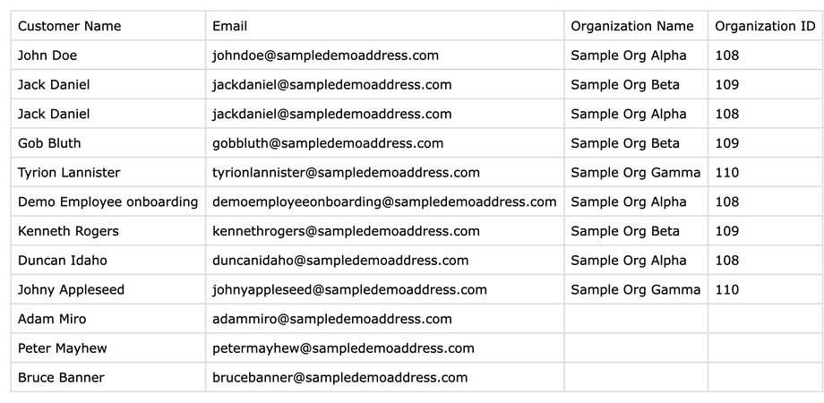

# Customer & Organization Export for JSM

Export a Jira Service Management project's Customers and Organizations to one CSV file, from a single screen in Jira.

[Get it on the Atlassian Marketplace](https://marketplace.atlassian.com/apps/2507427402/customer-organization-export-for-jsm) · [Documentation](https://asunokio-official.github.io/customer-organization-export-jsm-docs/documentation.html) · [Quick start](https://asunokio-official.github.io/customer-organization-export-jsm-docs/documentation.html#quick-start)

*Sample data only.*

## What it solves

Jira can export portal-only customers site-wide, but it has no built-in export of one project's Customers with their Organizations. Atlassian's own workaround is a Python script that needs an API token. This app does it from a screen in Jira. See the [guide to what Jira exports natively and when you need an app](https://asunokio-official.github.io/customer-organization-export-jsm-docs/export-jsm-customers-organizations-to-csv.html).

## Who it is for

Jira Service Management agents and admins who need a list of a project's Customers and the Organizations they belong to, for example for an audit or a spreadsheet.

## What it does

- Open the app from the Apps menu, choose a project, click **Export CSV**.
- The CSV has Customer Name, Email, Organization Name and Organization ID.
- One row per membership: a Customer in two Organizations appears on two rows. A Customer with no Organization gets one row with the last two columns blank.
- Runs in your browser with your own Jira session. Nothing is uploaded or stored by the app.

## Limits to know about

- One project at a time. It only exports; it does not import, edit, filter or schedule.
- You need Service Management agent access to the project. The app sees only what you can already see.
- It uses Jira endpoints that Atlassian marks as experimental, so they can change without notice.
- Large projects with many Organizations take longer, because member lists are read one Organization at a time.

## Install

A Jira administrator installs the app from the [Marketplace listing](https://marketplace.atlassian.com/apps/2507427402/customer-organization-export-for-jsm) with **Try it free**. If you are not an administrator, the listing lets you submit a request to your administrator.

## Support

Email [support@asunoki.jp](mailto:support@asunoki.jp). Issues in this repository are public, so please do not post customer data or confidential details there.

See also the [Privacy Policy](https://asunokio-official.github.io/customer-organization-export-jsm-docs/privacy-policy.html).

Vendor: Seisuke Nagahara (ASUNOKI). An independently developed Marketplace app, not affiliated with or endorsed by Atlassian beyond the standard Marketplace listing.
